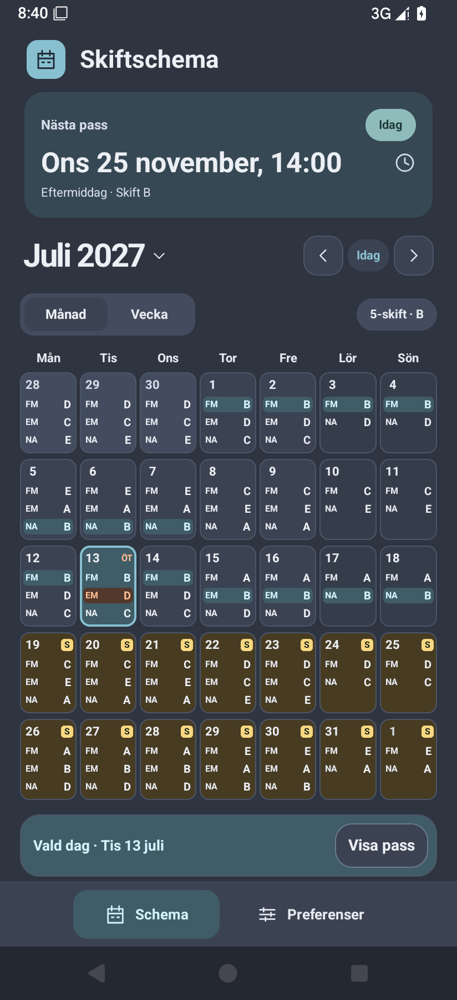
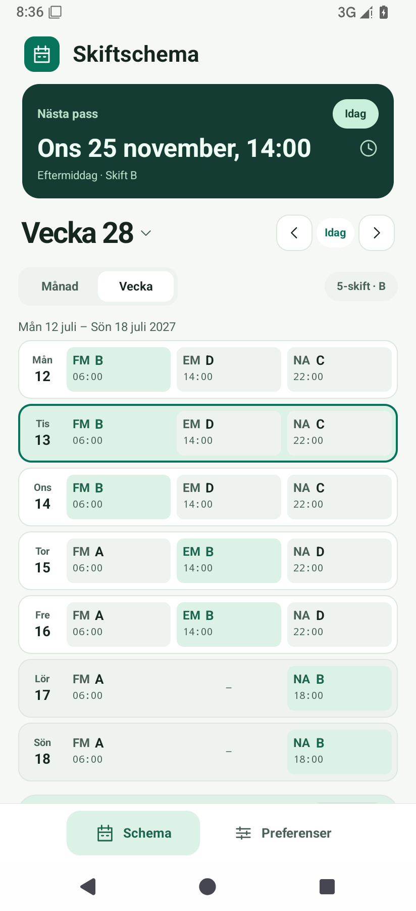
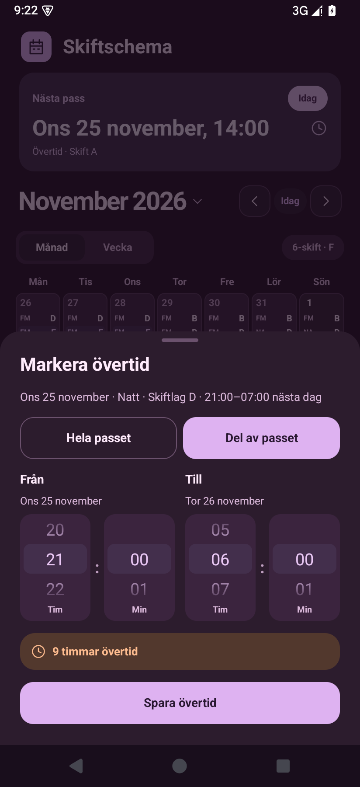
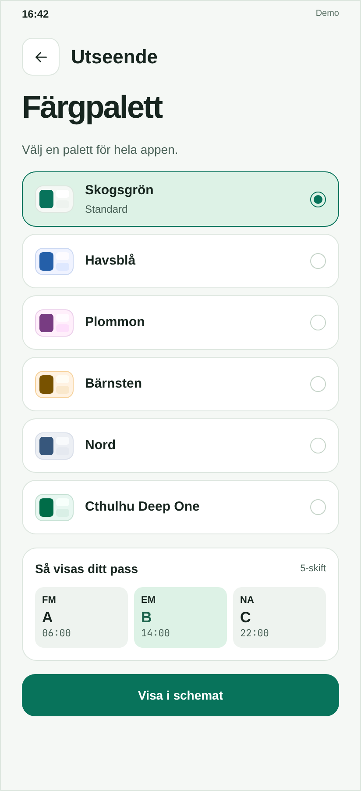

# Skiftschema


Skiftschema is a Swedish-language mobile app for looking up your work shifts. It includes the 2026 and 2027 rosters for **5-skift** and **6-skift**. The schedules work offline, and your preferences and overtime are stored on your device.



This branch builds Skiftschema for Android with native Android views and Java. The Expo project also provides the iOS and browser versions.

## Using the app

1. Choose your schedule and shift team. If you work 5-skift, you can also select your vacation group. You can change these choices under **Preferenser**.
2. Tap a day to select it. Double-tap in **Månad** to open that day’s week. Swipe sideways to move through the calendar. Use **Månad** or Android Back to return to the month with your selected day highlighted.
3. Hold a day to see every shift and its times. You can log overtime for all or part of another team’s shift.

The calendar highlights your shifts and shows your next one. Choose Light, Dark, or System under **Preferenser → Utseende**, where you can also change the color palette.

### Phone calendar export

Enable **Preferenser → Kalenderexport**, choose what to export, then tap **Uppdatera kalender**. Skiftschema exports to a separate calendar named **Skiftschema**. Automatic updates are optional, and reminders are off by default.

On Android, the exported calendar is stored locally. If it’s missing from Google Calendar’s menu, open **☰ → Inställningar → Hantera konton** and enable **se.skiftschema.app** under **Konton utanför Google**. Then check **Skiftschema** in the calendar menu.

## Development

Open `android/` in Android Studio, or build from the command line with JDK 17 and Android SDK Platform 35. The app supports Android 7.0 (API 24) and later.

```sh
cd android
./gradlew :app:assembleDebug :app:lintDebug
./gradlew :app:installDebug
```

Launch **Skiftschema** from the connected phone or emulator. The app bundles every matching roster in `data/` and stores preferences, overtime, and export settings in SQLite. Installing a build signed with the same key upgrades the existing Android app and carries over its local data. Keep signing keys and release credentials outside the repository.

The Expo browser preview uses Node.js 22.13+, 24.3+, or 26+.

```sh
npm ci
npm run preview
npm run check
npm test
```

The browser preview opens with onboarding. Its demo opens July 2027 with a preset crew and vacation group. Both simulate phone calendar export. [Demo](http://localhost:8081/?demo=1) · [Default preview](http://localhost:8081/)

[Schedule import guide](docs/development.md) · [Editable FigCraft design](docs/Skiftschema.figcraft)
